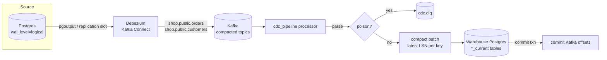

# realtime-cdc-pipeline

[](https://github.com/CodeWithSubramani/realtime-cdc-pipeline/actions/workflows/ci.yml)

**Change data capture from Postgres to an analytics warehouse:** Debezium → Kafka → a Python
processor that applies changes **idempotently and order-safely**, with a dead-letter queue and
event-time windowing for real-time metrics.

The interesting part isn't moving bytes. It's **staying correct when things go wrong**: redelivery,
consumer rebalances, replays from an old offset, out-of-order events, poison messages, and a
warehouse that goes down mid-batch.



## Guarantees and how they're achieved

| Guarantee | Mechanism |
|---|---|
| **No data loss** | Offsets committed only *after* the sink transaction commits (at-least-once). DLQ is flushed before offsets are committed. |
| **No duplicates / effectively-once** | Every upsert carries the source WAL position (`_lsn`). The guard is *inside* the SQL: `ON CONFLICT DO UPDATE ... WHERE target._lsn < excluded._lsn`. Replays are no-ops. |
| **Order-independence** | Same guard: an older event can never overwrite a newer one. A test applies **every permutation** of insert/update/update/delete and asserts identical final state. |
| **Deletes can't be resurrected** | Soft deletes (`_deleted = true`) keep the row and its version, so a late, older insert loses the version check. |
| **Atomic batches** | One DB transaction per poll batch; failure rolls back everything, nothing is committed to Kafka. |
| **Poison isolation** | Malformed/unsupported events go to `cdc.dlq` with `error`, `source_topic/partition/offset` headers. One bad record doesn't stop the stream. |
| **Transient failure tolerance** | Bounded exponential backoff on the warehouse; on exhaustion the process exits *without* committing and is restarted by the orchestrator. |

Why not Kafka transactions / exactly-once semantics? EOS covers Kafka→Kafka. The sink here is an
external database, so the practical answer is **at-least-once delivery + idempotent writes keyed on
a monotonic source version**. It's simpler, has no coordinator, and survives replays from any offset.

## Running it

```bash
make install && make test          # unit tests: no Docker, no Kafka needed

make up                            # Postgres x2, Kafka (KRaft), Debezium Connect, processor
make register                      # register the Debezium connector
make generate                      # 60s of inserts / status transitions / deletes
make check                         # source vs warehouse live-row counts should match
```

## Design decisions

- **WAL position as the version, not `updated_at`.** Application timestamps collide, skew between
  hosts and can be set by buggy code. The LSN is assigned by Postgres and is strictly ordered.
- **Guard in the database, not the consumer.** No read-before-write, no in-memory state to rebuild
  after a rebalance, and correct even with multiple writers.
- **Micro-batch compaction.** Hot rows change many times per second; only the highest-LSN event per key
  in a batch matters for a current-state table. This cuts write amplification without affecting
  correctness (the guard still handles cross-batch ordering).
- **`REPLICA IDENTITY FULL` + heartbeat table.** Full before-images make deletes carry every column, so
  a delete that arrives before older updates still converges. The heartbeat keeps the replication slot
  moving when tables are quiet; otherwise WAL accumulates on the source until its disk fills, a common
  Debezium failure.
- **Column allow-list per table** (`config/tables.yml`). PII such as `customers.email` is never
  replicated. That's a governance decision made in config and reviewed in a PR.
- **Compacted topics with tombstones.** New consumers can bootstrap from the topic, and log
  compaction eventually drops deleted keys.
- **Cooperative-sticky assignment.** Incremental rebalances avoid stop-the-world pauses when scaling
  the consumer group.

## Real-time metrics: event-time windows

`windows.py` implements tumbling windows with watermarks and allowed lateness, the same model as
Flink and Spark Structured Streaming:

- watermark = max event time − max out-of-orderness
- a window is emitted when the watermark passes its end
- events within `allowed_lateness` re-emit a **correction** (`is_update=True`), so downstream must
  upsert by window key
- events later than that go to a **side output** and are reconciled by the batch layer, never
  silently dropped

The trade-off is stated plainly: real-time numbers are *provisional*, and the nightly batch is the
source of truth.

## Layout

```
src/cdc_pipeline/
  events.py      Debezium envelope -> ChangeEvent (handles schema-wrapped JSON, tombstones, poison)
  sink.py        guarded upsert / soft delete, single transaction per batch
  batching.py    per-key compaction
  processor.py   consume -> parse -> DLQ -> compact -> apply (retry) -> commit
  windows.py     event-time tumbling windows, watermarks, lateness, side output
  config.py      env + tables.yml
connectors/      Debezium connector config (secrets via FileConfigProvider)
sql/             source schema, replication role, heartbeat
tests/           permutation convergence, replay idempotency, DLQ, retry/no-commit, windows
```

## What I'd add for production

- Schema Registry + Avro/Protobuf with compatibility rules (pairs with
  [dq-contracts](https://github.com/CodeWithSubramani/dq-contracts))
- SCD2 history table alongside `*_current` (append every version, close previous by LSN)
- Lag, DLQ-rate and replication-slot-size alerts (slot size is the early warning for source disk risk)
- Reconciliation job comparing source and warehouse counts/checksums per partition
